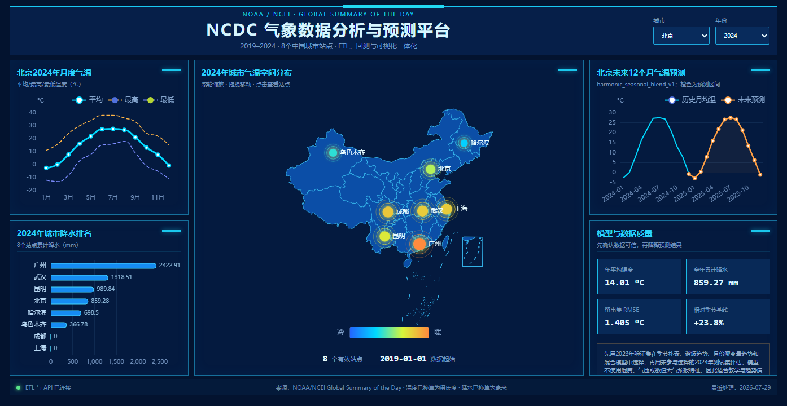

# NCDC 气象数据分析与可视化

基于 NOAA/NCEI（原 NCDC）GSOD 公开气象数据的本地数据处理与可视化项目，覆盖数据清洗、统计汇总、时间序列评估、数据库存储、API 和交互大屏。



## 已实现功能

- 处理 2019—2024 年、8 个中国城市代表站点的数据，清洗后保留 17,365 条日观测记录，生成 576 条月度汇总。
- 使用 Python/Pandas 识别缺失值与哨兵值，完成单位换算、站点日期去重、取值范围检查和月度聚合。
- 使用 SQLite 保存观测明细、统计结果、预测结果和 ETL 运行记录；通过 Django JSON API 提供数据。
- 使用 React、Apache ECharts 展示地图、气温趋势、降水对比和预测结果，支持城市及年份筛选。
- 比较季节朴素、谐波趋势、月份哑变量趋势及混合模型，使用 2023 年验证集选型、2024 年独立测试，输出 MAE、RMSE 与基线比较结果。
- 提供 Hadoop Streaming Mapper/Reducer、HiveQL 和 Sqoop/MySQL 扩展脚本。

## 技术栈

| 环节 | 技术 |
| --- | --- |
| 数据处理 | Python、Pandas、NumPy |
| 本地存储与服务 | SQLite、Django |
| 前端可视化 | React、Apache ECharts、Vite |
| 大数据扩展脚本 | Hadoop Streaming、Hive、Sqoop、MySQL |

## 本地运行

干净的源码环境需要 **Python 3.10+、Node.js 20+ 和 npm**，并能够联网安装依赖。Windows 可在项目根目录的 PowerShell 中运行：

```powershell
Set-ExecutionPolicy -Scope Process Bypass
.\scripts\quick_start.ps1
```

首次运行将创建虚拟环境、安装 Python/前端依赖、构建前端并执行数据处理流程。源码仓库包含 48 个公开气象 CSV 样本文件，不包含虚拟环境、依赖缓存、前端构建产物或本地数据库。

启动后访问 <http://127.0.0.1:8000/>。在启动窗口按 `Ctrl+C` 停止。

后续启动：

```powershell
.\scripts\start.ps1
```

其他系统可分别安装依赖、构建前端并运行服务：

```bash
python -m venv .venv
# 激活虚拟环境后执行以下命令
pip install -r requirements.txt
cd frontend
npm ci
npm run build
cd ..
python -m pipeline.run_pipeline
python backend/manage.py runserver 127.0.0.1:8000 --noreload
```

## 数据处理链路

```text
NOAA/NCEI GSOD CSV
  → Pandas 清洗与质量校验
  → 日观测明细 / 月度统计 / 预测及评估结果
  → SQLite
  → Django API
  → React + ECharts
```

日观测主键为“站点 + 日期”；月度统计粒度为“城市 + 年 + 月”。温度由华氏度转为摄氏度，降水由英寸转为毫米。原始缺失降水不会直接填为 0。

## 验证

先执行数据处理，再运行测试：

```bash
python -m pipeline.run_pipeline
python -m unittest discover -s tests -v
cd frontend
npm run build
npm run test:sites
```

Python 测试覆盖数据范围、月度唯一性、模型评估、SQLite、API 及 Streaming 本地输入输出流程。`test:sites` 用于校验项目附带的前端部署适配文件。

## 大数据扩展范围

Hadoop Streaming 脚本已完成本地管道测试；仓库还提供 Hive 外部表、ORC 汇总查询、MySQL 建表与 Sqoop 导出脚本。**这些扩展尚未在真实 Hadoop/Hive/Sqoop 集群完成运行验证，不能视为已完成集群部署。**

MySQL 密码通过 `WEATHER_DB_PASSWORD` 环境变量设置，不写入源码。默认 Django 密钥仅用于本地演示，服务默认只监听 `127.0.0.1`。

## 数据与模型边界

- 每个城市仅使用一个代表站点，不能将结果解释为省域平均。
- 上海、成都降水记录覆盖率不足；系统仅在覆盖率达到 80% 且存在正降水时展示年度降水排名。
- 统计模型只使用历史月均温，不能替代生产气象预报；部分城市测试结果没有优于季节朴素基线。
- 详细口径与缺失情况见 [数据质量说明](DATA_QUALITY.md)。

## 目录

```text
data/raw/       公开气象样本
pipeline/       数据清洗、聚合、预测与入库
backend/        Django 服务与 API
frontend/       React 大屏与前端部署适配
hadoop/         Streaming Mapper/Reducer
hive/           HiveQL 扩展脚本
mysql/          MySQL 表结构
sqoop/          Sqoop 导出脚本
scripts/        Windows 安装与启动脚本
tests/          Python 自动测试
docs/           页面预览
```

## 数据来源

[NOAA/NCEI Global Summary of the Day](https://www.ncei.noaa.gov/data/global-summary-of-the-day/access/)。项目使用的原始数据可通过 `python -m pipeline.fetch_ncei` 重新下载，运行前应考虑远端数据更新可能带来的记录变化。
